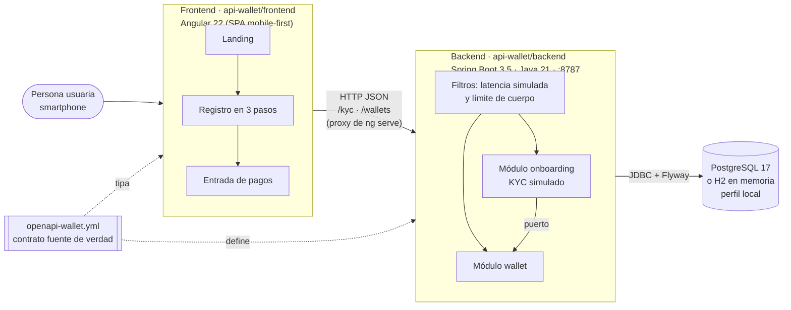
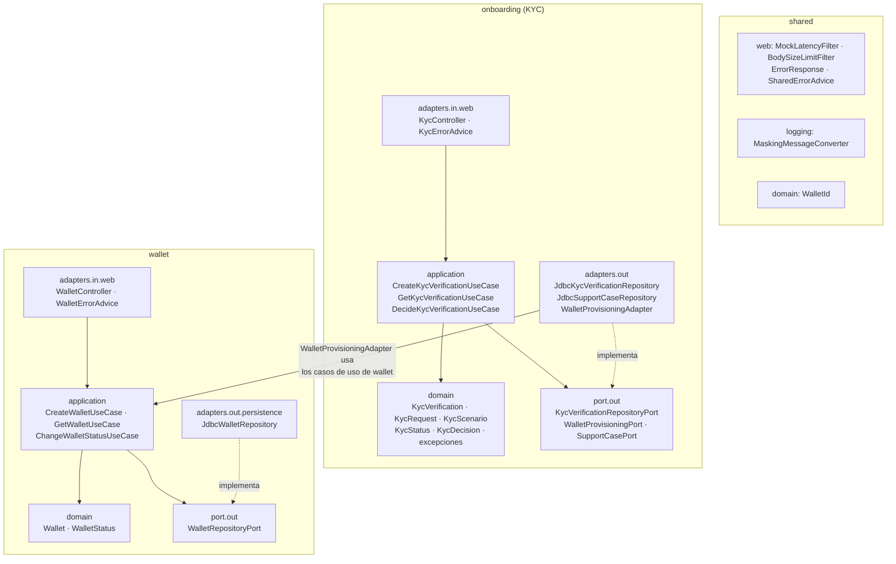
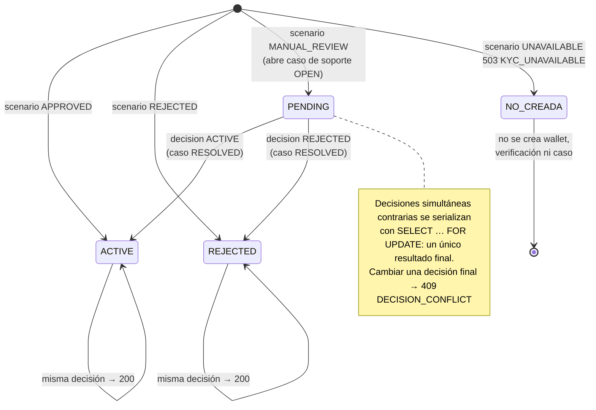
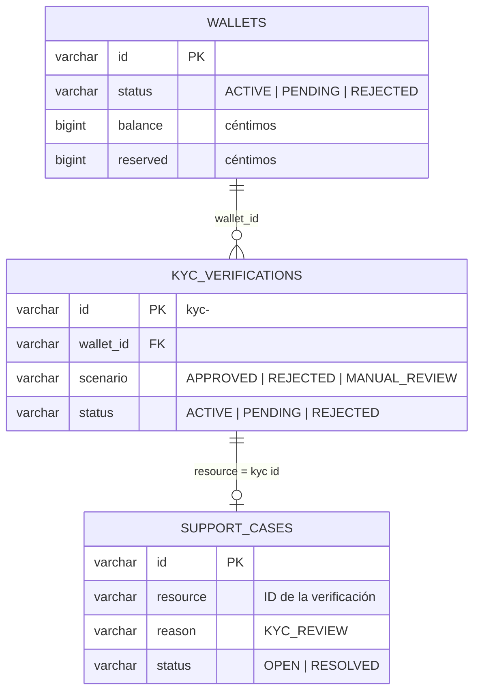
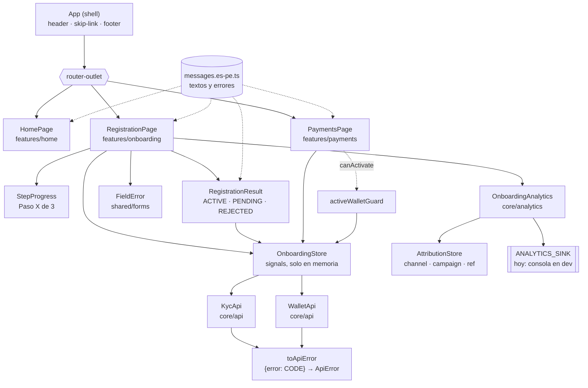
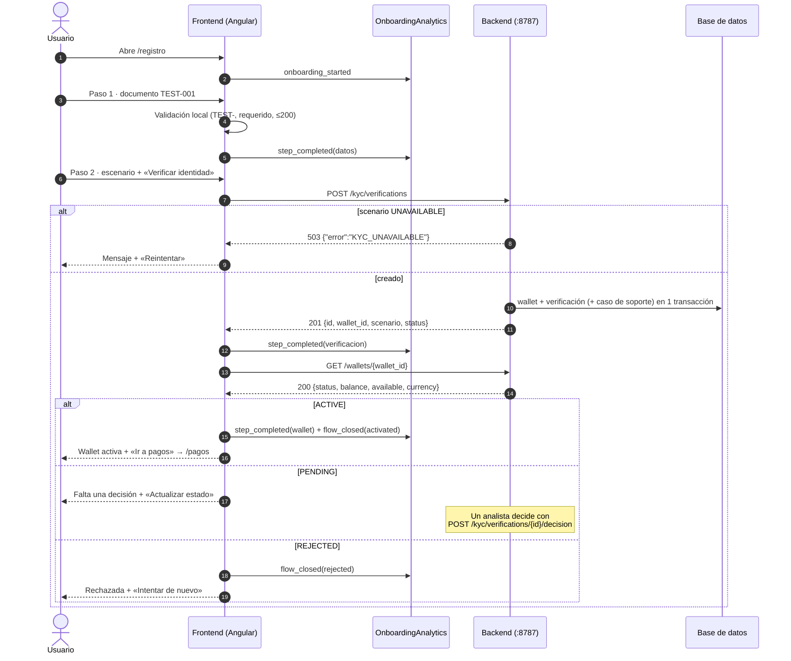

# Al toque · Wallet Hackathon

Billetera digital (MVP para Perú) para pagos cotidianos de bajo monto: transferencias y cobros con QR.
El proyecto se construye con **desarrollo guiado por especificaciones** ([OpenSpec](https://github.com/Fission-AI/OpenSpec)).
Las historias de usuario se convierten en *changes* con propuesta, diseño, specs y tareas. Luego se implementan en un
backend Spring Boot y un frontend Angular que comparten un único contrato HTTP.

> **Estado:** la historia **W1 · Registro y activación** está implementada de punta a punta (backend + frontend).
> El núcleo de pagos (`payment-core`, W2–W6) está especificado y pendiente de implementar.

---

## Contenido

1. [Objetivos del producto](#objetivos-del-producto)
2. [Estado por historia](#estado-por-historia)
3. [Arquitectura general](#arquitectura-general)
4. [Backend](#backend)
5. [Frontend](#frontend)
6. [Flujo W1 de punta a punta](#flujo-w1-de-punta-a-punta)
7. [Desarrollo guiado por especificaciones](#desarrollo-guiado-por-especificaciones)
8. [Stack y versiones](#stack-y-versiones)
9. [Cómo ejecutar](#cómo-ejecutar)
10. [Pruebas](#pruebas)
11. [Estructura del repositorio](#estructura-del-repositorio)
12. [Decisiones de arquitectura](#decisiones-de-arquitectura)
13. [Pendientes y próximos pasos](#pendientes-y-próximos-pasos)

---

## Objetivos del producto

Definidos en la épica [`resources/epic/peru-wallet-mvp.sp.md`](resources/epic/peru-wallet-mvp.sp.md). En un trimestre:

| Objetivo | Meta |
| --- | --- |
| Caída en checkout | de 30 % a **8 %** |
| Tiempo de onboarding | de 8 min a **3 min** |
| Usuarios activos mensuales (MAU), meses 1–3 | **1,000 – 2,000** |
| Costo de adquisición (CAC), meses 1–3 | **PEN 10** por usuario nuevo |

Usuarios objetivo:
- Personas con smartphone que hacen transferencias diarias de bajo monto.
- Pequeños comercios que cobran con QR.

## Estado por historia

| Historia | Descripción | Change OpenSpec | Estado |
| --- | --- | --- | --- |
| [W1](resources/user-stories/w1-user-onboarding-mvp-completion.sp.md) | Registro y activación (KYC simulado) | [`add-wallet-onboarding`](openspec/changes/add-wallet-onboarding/) | ✅ Backend y frontend |
| [W2](resources/user-stories/w2-payer-low-value-payment-confirmation.sp.md) | Confirmación de pago de bajo monto | [`payment-core`](openspec/changes/payment-core/) | 📝 Especificado |
| [W3](resources/user-stories/w3-merchant-qr-payment-status-visibility.sp.md) | Estado de pagos QR para comercios | `payment-core` | 📝 Especificado |
| [W4](resources/user-stories/w4-payment-failure-reversal-handling.sp.md) | Fallas y reversos | `payment-core` | 📝 Especificado |
| [W5](resources/user-stories/w5-payment-idempotency-protection.sp.md) | Protección por idempotencia | `payment-core` | 📝 Especificado |
| [W6](resources/user-stories/w6-operations-transaction-reconciliation.sp.md) | Conciliación de operaciones | `payment-core` | 📝 Especificado |

---

## Arquitectura general



Principios:
- **Un solo contrato.** [`openapi-wallet.yml`](api-wallet/backend/src/main/resources/openapi-wallet.yml) (OpenAPI 3.0.3) define rutas, cuerpos, códigos de estado y errores (`{"error": "CODE"}`).
- **Monolito modular hexagonal.** Cada módulo tiene `domain`, `application` y `adapters`, y los módulos se comunican solo por puertos.
- **Proveedor simulado.** El KYC no valida documentos reales: el campo `scenario` de la solicitud decide el resultado.
- **Sin autenticación ni sesiones** en el MVP, una decisión explícita de diseño.

---

## Backend

Ubicación: [`api-wallet/backend`](api-wallet/backend).
Stack: Spring Boot 3.5.16, Java 21, Maven, JDBC (sin JPA), Flyway y PostgreSQL.

### Arquitectura hexagonal por módulo



Reglas que hace cumplir ArchUnit ([`HexagonalArchitectureTest`](api-wallet/backend/src/test/java/com/wallet/HexagonalArchitectureTest.java)):
- `domain` no depende de Spring, de `application` ni de adaptadores.
- `onboarding` y `wallet` no se conocen entre sí. `onboarding` crea y cambia wallets solo a través de `WalletProvisioningPort`.

### API (W1)

| Método | Ruta | Cuerpo | Éxito | Errores |
| --- | --- | --- | --- | --- |
| `POST` | `/kyc/verifications` | `{documentType, document, scenario?}` | `201` Kyc | `400 INVALID_REQUEST`, `413 PAYLOAD_TOO_LARGE`, `503 KYC_UNAVAILABLE` |
| `GET` | `/kyc/verifications/{id}` | — | `200` Kyc | `404 NOT_FOUND` |
| `POST` | `/kyc/verifications/{id}/decision` | `{decision}` | `200` Kyc | `400 INVALID_DECISION`, `404 NOT_FOUND`, `409 DECISION_CONFLICT` |
| `GET` | `/wallets/{id}` | — | `200` Wallet | `404 NOT_FOUND` |

**Reglas de la solicitud:**
- `documentType` debe ser `TEST`.
- `document` debe empezar con `TEST-` y tener como máximo 200 caracteres.
- `scenario` es uno de `APPROVED` (predeterminado), `REJECTED`, `MANUAL_REVIEW` o `UNAVAILABLE`.
- El backend no evita los registros repetidos, por exigencia del contrato.

**Respuestas:**
- Kyc: `{ id, wallet_id, scenario, status }`. El ID de verificación es distinto del `wallet_id`.
- Wallet: `{ id, status, balance, reserved, available, currency: "PEN" }`. Los importes son enteros en **céntimos** y `available = balance − reserved`.

**Comportamiento de todas las rutas:**
- **Latencia simulada:** el header `X-Mock-Latency-Ms` o el parámetro `?latency=` (0–5000 ms; el header gana) retrasa la respuesta. Un valor inválido devuelve `400 INVALID_MOCK_LATENCY`.
- **Límite de cuerpo:** un cuerpo declarado mayor a 65536 bytes devuelve `413`.
- **Privacidad:** los logs nunca incluyen el documento. El conversor de logback enmascara números y fechas, y una prueba lo verifica.

La wallet `wallet-demo` viene precargada `ACTIVE` con 100000 céntimos (S/ 1,000.00).

### Estados de la verificación KYC



La wallet sigue siempre el estado de su verificación. Verificación, wallet y caso de soporte se crean en una sola transacción.

### Modelo de datos

Las migraciones Flyway están en [`db/migration`](api-wallet/backend/src/main/resources/db/migration).



---

## Frontend

Ubicación: [`api-wallet/frontend`](api-wallet/frontend).
Stack: Angular 22 (componentes *standalone*, signals, control flow nativo, zoneless), Reactive Forms tipados, Vitest y Playwright.
Diseño: tema oscuro «Al toque», tomado de [`pantalla1.png`](api-wallet/frontend/pantalla1.png) y [`pantalla2.png`](api-wallet/frontend/pantalla2.png).

### Rutas

| Ruta | Pantalla | Notas |
| --- | --- | --- |
| `/` | Landing | «Regístrate» y «Ya tengo cuenta» llevan al registro, porque no existe inicio de sesión. |
| `/registro` | Registro en 3 pasos | «Paso X de 3» y la lista de pasos siempre visibles. |
| `/pagos` | Entrada de pagos de bajo monto | Protegida por `activeWalletGuard`: solo con wallet `ACTIVE`. Las acciones aparecen como «Próximamente» hasta W2. |

Todas las rutas se cargan de forma diferida (`loadComponent`).

### Componentes



| Carpeta | Contenido |
| --- | --- |
| `core/api` | Modelos tipados del contrato (`Kyc`, `Wallet`, `CreateKycRequest`), los clientes `KycApi` y `WalletApi`, y `toApiError`. |
| `core/i18n` | Catálogo es-PE con todos los textos y el mapeo de cada código de error a su mensaje. |
| `core/analytics` | `OnboardingAnalytics` y `AttributionStore`. |
| `features/home` | Landing. |
| `features/onboarding` | `RegistrationPage`, `StepProgress`, `RegistrationResult` y `OnboardingStore`. |
| `features/payments` | `PaymentsPage` y `activeWalletGuard`. |
| `shared` | `FieldError`, `focusFirstInvalid`, la pipe `penCents` (céntimos → `S/ 1,000.00`) e íconos SVG. |

### Pasos del registro

1. **Tus datos.** Se ingresa el tipo de documento (`TEST`) y el número (prefijo `TEST-`). Si el dato falta o es inválido, no se puede avanzar y se muestra un mensaje que indica cómo corregirlo.
2. **Verificación.** Se muestra un resumen de los datos y se elige el escenario a simular.
   - `KYC_UNAVAILABLE`: aparece «Reintentar».
   - `INVALID_REQUEST`: aparece «Corregir mis datos».
3. **Tu wallet.** Se muestra el resultado según el estado:
   - `ACTIVE`: saldo e «Ir a pagos».
   - `PENDING`: explica que falta una decisión y ofrece «Actualizar estado».
   - `REJECTED`: ofrece «Intentar de nuevo».

### Analítica del onboarding

`OnboardingAnalytics` emite tres eventos:
- `onboarding_started`
- `step_completed`, con `step` y `stepDurationMs`
- `flow_closed`, con `outcome`: `activated`, `pending_review`, `rejected` o `abandoned`

Cada evento lleva `flowId`, `elapsedMs` y la atribución `channel`/`campaign`/`ref` tomada de la URL de entrada. Esos datos sirven para medir la mediana de 3 min y el CAC por canal.

Los eventos **no contienen datos personales**: ni el documento ni los IDs de wallet.

Todavía no se envían a ningún lado: el contrato no tiene un endpoint de analítica y el destino (`ANALYTICS_SINK`) solo escribe en la consola en desarrollo. Ver [pendientes](#pendientes-y-próximos-pasos).

### Accesibilidad y rendimiento

- WCAG 2.2 AA:
  - etiquetas y `aria-describedby` en cada campo;
  - `aria-invalid` en los campos con error;
  - el foco va al primer error, a las alertas y al resultado;
  - objetivos táctiles de al menos 44 px;
  - enlace para saltar al contenido;
  - contraste AA en el tema oscuro.
- Presupuestos de bundle en `angular.json` (inicial: aviso en 300 kB, error en 500 kB). Hoy el bundle inicial pesa unos 78 kB transferidos.
- No se guardan datos personales en `localStorage`.

---

## Flujo W1 de punta a punta



---

## Desarrollo guiado por especificaciones

```mermaid
flowchart LR
    E["Épica<br/>resources/epic"] --> US["Historias W1–W6<br/>resources/user-stories"]
    US --> P["/opsx-propose<br/>proposal.md"]
    P --> D["design.md<br/>decisiones D1…Dn"]
    D --> S["specs/*/spec.md<br/>Requirements + Scenarios"]
    S --> T["tasks.md<br/>tareas verificables"]
    T --> A["/opsx-apply<br/>agentes por rol"]
    A --> CODE["Código + pruebas<br/>por escenario"]
    CODE --> QA["Trazabilidad<br/>docs/qa"]
    QA --> AR["/opsx-archive<br/>openspec/specs"]
```



| Elemento | Ubicación |
| --- | --- |
| Changes activos | [`openspec/changes/add-wallet-onboarding`](openspec/changes/add-wallet-onboarding) (W1) y [`openspec/changes/payment-core`](openspec/changes/payment-core) (núcleo de pagos W2–W6) |
| Specs | Cada requisito usa `SHALL` y cada escenario usa `WHEN`/`THEN`. Las pruebas llevan el nombre del escenario, por ejemplo «Escenario aprobado» o «Proveedor no disponible». |
| Trazabilidad | [`api-wallet/docs/qa/add-wallet-onboarding-trazabilidad.md`](api-wallet/docs/qa/add-wallet-onboarding-trazabilidad.md): una fila por comportamiento del contrato y su prueba. |
| Validación | `openspec validate add-wallet-onboarding --strict` |
| Prompts | [`.github/prompts`](.github/prompts): `opsx-propose`, `opsx-apply`, `opsx-explore`, `opsx-update`, `opsx-sync` y `opsx-archive`. |
| Skills | [`.agents/skills`](.agents/skills): arquitectura hexagonal, SOLID, JUnit, code review, flujo OpenSpec y git. |

### Agentes por rol

En [`.github/agents`](.github/agents):

| Agente | Responsabilidad |
| --- | --- |
| `product-owner` | Épica, historias, criterios de aceptación y métricas. |
| `architect` | ADR, contrato OpenAPI y estructura. |
| `backend-java` | Módulos hexagonales Spring Boot. |
| `frontend-angular` | Pantallas mobile-first, accesibilidad y pruebas. |
| `qa-test` | Pruebas por escenario, E2E y trazabilidad. |
| `security-review` | Privacidad y datos personales. |
| `ia-engineer` | Rol full-stack. |
| `openspec` | Uso de la CLI. |

[`crewai-wallet/`](crewai-wallet) es un flujo opcional en **CrewAI** (Python). Lee una sección de `tasks.md`, asigna cada tarea al agente del rol adecuado y marca la tarea como hecha:

```bash
cd crewai-wallet && pip install -r requirements.txt && python main.py --section 5
```

Requiere un archivo `.env` con las credenciales del modelo.

---

## Stack y versiones

Fijadas en [ADR 001](api-wallet/docs/architecture/adr/001-stack.md). Cambiar una versión mayor exige actualizar el ADR.

| Capa | Tecnología | Versión |
| --- | --- | --- |
| Backend | Java (Temurin LTS) | 21.0.12.1 |
| | Spring Boot | 3.5.16 |
| | Maven (`./mvnw`) | 3.10.0 |
| | PostgreSQL | 17 (`postgres:17-alpine`) |
| | Flyway | 11.7.2 |
| | H2 (solo perfil `local`) | gestionada por Spring Boot |
| Frontend | Node.js / npm | 26.9.0 / 11.19.1 |
| | Angular / CLI | 22.2.4 / 22.2.6 |
| | TypeScript / RxJS | 6.0.3 / 7.8.2 |
| Pruebas | JUnit, AssertJ, Testcontainers, ArchUnit | 5.12.2, 3.27.7, 1.21.4, 1.5.1 |
| | Vitest + jsdom | 4.1.12 + 28.1.0 |
| | Playwright (Chromium, Pixel 7) | 1.65.0 |

---

## Cómo ejecutar

### 1. Backend (puerto 8787)

**Opción A: sin instalar base de datos (H2 en memoria, perfil `local`).** Los datos se pierden al reiniciar.

```bash
cd api-wallet/backend
./mvnw spring-boot:run -Dspring-boot.run.profiles=local
```

**Opción B: con PostgreSQL.** Usa por defecto `jdbc:postgresql://localhost:5432/wallet`, con usuario y contraseña `wallet`.

```bash
docker run -d --name wallet-db -p 5432:5432 \
  -e POSTGRES_DB=wallet -e POSTGRES_USER=wallet -e POSTGRES_PASSWORD=wallet postgres:17-alpine

cd api-wallet/backend
./mvnw spring-boot:run
```

| Variable | Predeterminado |
| --- | --- |
| `PORT` | `8787` |
| `DB_URL` | `jdbc:postgresql://localhost:5432/wallet` |
| `DB_USER` / `DB_PASSWORD` | `wallet` / `wallet` |

Prueba rápida:

```bash
curl http://127.0.0.1:8787/wallets/wallet-demo
curl -X POST http://127.0.0.1:8787/kyc/verifications \
  -H "Content-Type: application/json" \
  -d '{"documentType":"TEST","document":"TEST-001","scenario":"MANUAL_REVIEW"}'
```

### 2. Frontend (puerto 4200)

```bash
cd api-wallet/frontend
npm install
npm start
```

La app queda en http://localhost:4200. El proxy ([`proxy.conf.json`](api-wallet/frontend/proxy.conf.json)) envía `/kyc` y `/wallets` a `http://127.0.0.1:8787`, así que no hace falta configurar CORS en el backend.

Para probar la atribución, abre `http://localhost:4200/?channel=facebook&campaign=lanzamiento&ref=abc`. Los eventos aparecen en la consola del navegador.

### 3. Simular la decisión de una revisión manual

```bash
curl -X POST http://127.0.0.1:8787/kyc/verifications/<kyc-id>/decision \
  -H "Content-Type: application/json" -d '{"decision":"ACTIVE"}'
```

Después, en la pantalla de resultado, pulsa «Actualizar estado».

---

## Pruebas

| Capa | Comando | Qué cubre |
| --- | --- | --- |
| Backend | `./mvnw clean verify` | Dominio, casos de uso con fakes, API con MockMvc, migraciones, concurrencia de decisiones, latencia, privacidad de logs y reglas ArchUnit. Requiere Docker por Testcontainers. |
| Frontend unitarias | `npm test` | Cliente HTTP, mapeo de errores, cada escenario del spec, pasos, analítica, guard de pagos y accesibilidad. |
| Frontend build | `npm run build` | Compilación de producción con presupuestos de bundle. |
| E2E | `npx playwright install chromium` y luego `npm run e2e` | Flujo móvil (Pixel 7): registro aprobado hasta pagos, error recuperable, entrada inválida, protección de `/pagos` y tamaño de los botones. Simula el backend con `page.route`. |
| Specs | `openspec validate add-wallet-onboarding --strict` | Estructura y consistencia del change. |

---

## Estructura del repositorio

```text
wallet-hackathon/
├── api-wallet/
│   ├── backend/                 # Spring Boot (módulos onboarding, wallet, shared)
│   │   └── src/main/resources/  # openapi-wallet.yml, application*.yml, db/migration
│   ├── frontend/                # Angular (core, features, shared, e2e)
│   └── docs/
│       ├── architecture/adr/    # ADR 001: stack y versiones
│       └── qa/                  # matriz de trazabilidad W1
├── openspec/
│   ├── config.yaml
│   ├── changes/                 # add-wallet-onboarding (W1), payment-core (W2–W6)
│   └── specs/                   # specs consolidadas (al archivar changes)
├── resources/
│   ├── epic/                    # épica MVP Perú
│   ├── user-stories/            # W1–W6
│   └── mocks/                   # guía de uso del mock W1
├── .github/                     # agentes, prompts opsx-*, skills, workflows
├── .agents/skills/              # skills de ingeniería reutilizables
├── crewai-wallet/               # orquestación opcional de agentes con CrewAI
└── presentacion-al-toque.html   # presentación del concepto
```

---

## Decisiones de arquitectura

| Decisión | Resumen | Fuente |
| --- | --- | --- |
| Stack y versiones exactas | Java 21, Spring Boot 3.5, PostgreSQL 17, Angular 22, Vitest y Playwright. | [ADR 001](api-wallet/docs/architecture/adr/001-stack.md) |
| D1. Contrato como fuente de verdad | `openapi-wallet.yml` define rutas y errores `{"error":"CODE"}`. Se descartaron Problem Details e `Idempotency-Key` para W1. | [design.md](openspec/changes/add-wallet-onboarding/design.md) |
| D2. El escenario determina el resultado | `APPROVED`→`ACTIVE`, `REJECTED`→`REJECTED`, `MANUAL_REVIEW`→`PENDING`, `UNAVAILABLE`→503. Todo se crea en una transacción. | design.md |
| D3. Módulos aislados por puertos | `WalletProvisioningPort` y `SupportCasePort`, verificados con ArchUnit. | design.md |
| D4. Resultado final único | La decisión se lee con `SELECT … FOR UPDATE`, con prueba de concurrencia. | design.md |
| D5. Importes en céntimos | `available = balance − reserved` y `wallet-demo` con 100000. | design.md |
| D6. Latencia y límite de cuerpo | Filtros de servlet que responden con errores en el formato del contrato. | design.md |
| D7. Logs sin documento | Enmascarado en logback y prueba de privacidad. | design.md |
| Frontend: pasos en el cliente | El contrato no entrega la definición de pasos, así que el stepper de 3 pasos vive en el frontend. | Acordado en la implementación de W1 |
| Frontend: proxy en desarrollo | `ng serve` redirige al 8787, sin cambios de CORS en el backend. | tasks.md 5.1 |

---

## Pendientes y próximos pasos

- **Núcleo de pagos (`payment-core`).** Ciclo de vida del pago, idempotencia, proveedor simulado, ledger y eventos. Habilitará las acciones de `/pagos`, hoy marcadas como «Próximamente».
- **Endpoint de analítica.** Hace falta un cambio OpenSpec aparte para persistir los eventos del onboarding y calcular:
  - la mediana de la duración (meta: 3 min);
  - los MAU mensuales;
  - el CAC por canal.

  En el frontend basta con reemplazar el proveedor de `ANALYTICS_SINK`.
- **Specs del frontend.** Registrar en OpenSpec el stepper visible y la pantalla de entrada a pagos, que hoy no están en las specs vigentes.
- **`GET /support/cases`.** Pregunta abierta en el diseño de W1, prevista para W5.
- **Códigos de error.** Confirmar con quien consume el mock los códigos `INVALID_REQUEST` y `PAYLOAD_TOO_LARGE`, que el contrato no define.
- **Agentes desactualizados.** Actualizar `.github/agents/frontend-angular.agent.md`, que aún describe el flujo anterior (stepper desde el servidor e `Idempotency-Key`).
- **Archivar el change.** Archivar `add-wallet-onboarding` cuando el Product Owner acepte la entrega.
